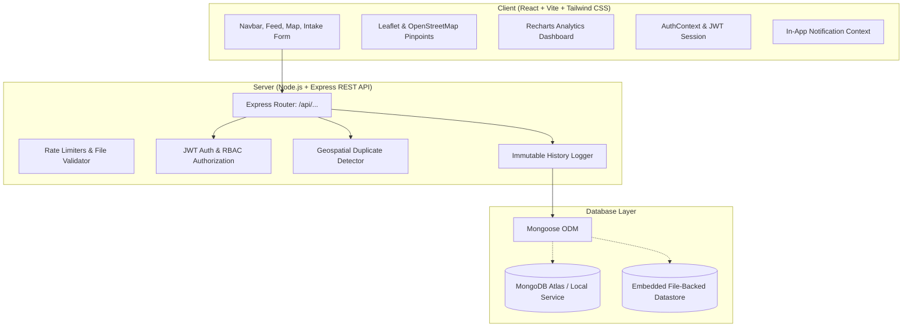

# CivicShield — Municipal Infrastructure Hazard Platform

**CivicShield** is a functional full-stack civic-tech application engineered for reporting, geospatial tracking, crew dispatching, and resolving municipal infrastructure hazards (e.g. fallen electrical lines, ruptured water mains, missing manhole covers, and severe road damage).

---

## 🏛️ System Architecture



---

## 🚀 Key Functional Capabilities

1. **Citizen Hazard Reporting**:
   - Comprehensive intake: Title, Category, Description, Address, Landmark, Urgency (`Low`, `Medium`, `Critical`).
   - Interactive Leaflet map location picker with "Use My GPS" browser detection.
   - Safe photo attachments with strict MIME validation (executable scripts rejected).
   - Generates unique public incident ID (e.g., `CS-2026-1001`).

2. **Server-Side Geospatial Duplicate Detection**:
   - Before saving, the backend queries for unresolved matching categories within 100 metres and a 72-hour window using spherical distance calculations.
   - Enforced on the backend (HTTP 409 warning) so it cannot be bypassed through the frontend.
   - Citizen can review the existing ticket or click **"Continue as Separate Report"** (`forceSubmit: true`).

3. **Multi-Role Operations**:
   - **Citizens**: Submit reports, inspect public incident map/feed, and track incidents anonymously or authenticated.
   - **Field Crews**: Review assigned dispatches, update progress (`Assigned` → `In Progress`), record on-site technical logs, and submit repair proof photos.
   - **Municipal Administrators**: Real-time KPI dashboard, triage critical hazards, assign specialized crews, reject non-qualifying reports with mandatory reasons, and audit complete history logs.

4. **Incident Lifecycle & Tamper-Proof Audit Trail**:
   - `Reported` → `Acknowledged` → `Assigned` → `In Progress` → `Verified` → `Resolved` (plus `Rejected`).
   - Every status change, assignment, and verification records an immutable timestamped log with the acting user's name and role.

5. **In-App Real-Time Notification Center**:
   - Working in-app alert dropdown with live unread badge, mark-as-read, and direct links to incident tickets.

---

## 🔑 Demonstration Accounts

The platform includes a built-in seed dataset with simulated municipal hazards and 1-click login buttons on the Sign In page:

| Role | Email | Password | Scope |
| :--- | :--- | :--- | :--- |
| **Citizen** | `citizen@civicshield.gov` | `demo123` | Report hazards, public tracking |
| **Field Crew** | `crew@civicshield.gov` | `demo123` | Electrical Safety unit, dispatch queue, verification |
| **Field Crew 2** | `crew2@civicshield.gov` | `demo123` | Roads & Water unit, dispatch queue |
| **Administrator**| `admin@civicshield.gov` | `demo123` | Operations Center, crew dispatch, metrics, audit logs |

> **Notice:** All seeded incident records and demo accounts are simulated demonstration data for municipal operations testing and do not represent active emergency dispatches.

---

## 🛠️ Installation & Running Locally

### Prerequisites
- Node.js (v18+ or v24+)
- npm (v9+)

### 1. Start the Backend API Server
```powershell
cd server
npm install
npm run seed     # Seeds demo accounts and realistic simulated incidents
npm start        # Starts server on http://localhost:5000
```

### 2. Start the Frontend Application
```powershell
cd client
npm install
npm run dev      # Starts Vite dev server on http://localhost:5173
```

Now open **http://localhost:5173** in your browser.

---

## 📡 REST API Reference

| Method | Endpoint | Access | Purpose |
| :--- | :--- | :--- | :--- |
| `POST` | `/api/auth/register` | Public | Register new citizen, crew, or admin |
| `POST` | `/api/auth/login` | Public | Authenticate user & receive JWT token |
| `GET` | `/api/auth/me` | Private | Retrieve current user profile |
| `GET` | `/api/auth/crews` | Admin/Crew | List available field crews for dispatch |
| `POST` | `/api/incidents` | Public/Auth | Submit hazard report (with duplicate check) |
| `GET` | `/api/incidents` | Public | Search, filter, and paginate incident feed |
| `GET` | `/api/incidents/:id` | Public | Incident detail, timeline & audit history |
| `PATCH`| `/api/incidents/:id/status` | Crew/Admin | Transition incident lifecycle status |
| `PATCH`| `/api/incidents/:id/assign` | Admin | Assign incident to a field crew |
| `POST` | `/api/incidents/:id/verification` | Crew/Admin | Record on-site technical inspection log |
| `POST` | `/api/incidents/:id/resolution` | Crew/Admin | Document final resolution & repair photos |
| `GET` | `/api/dashboard/stats` | Admin/Crew | Aggregated operational stats & categories |
| `GET` | `/api/dashboard/activity` | Admin/Crew | Real-time platform audit log stream |
| `GET` | `/api/notifications` | Private | Get user's in-app alert notifications |
| `PATCH`| `/api/notifications/:id/read` | Private | Mark notification as read |
| `POST` | `/api/uploads` | Public/Auth | Upload hazard evidence photos (max 5MB) |
| `GET` | `/api/health` | Public | Server uptime & datastore health check |

---

## 🌐 Production Deployment Guide

### Backend (Render / Railway / Fly.io)
1. Set the Root Directory to `server`.
2. Build Command: `npm install`
3. Start Command: `npm start`
4. Set Environment Variables:
   - `NODE_ENV=production`
   - `PORT=5000`
   - `MONGODB_URI=mongodb+srv://<user>:<password>@cluster.mongodb.net/civicshield` (MongoDB Atlas)
   - `JWT_SECRET=<strong_random_secret_string>`
   - `DUPLICATE_RADIUS_METERS=100`
   - `DUPLICATE_HOURS_WINDOW=72`

### Frontend (Vercel / Netlify)
1. Set Root Directory to `client`.
2. Build Command: `npm run build`
3. Output Directory: `dist`
4. Configure environment variable:
   - `VITE_API_URL=https://your-backend-api.onrender.com` (or configure reverse proxy rewrites in `vercel.json` / `_redirects`).
